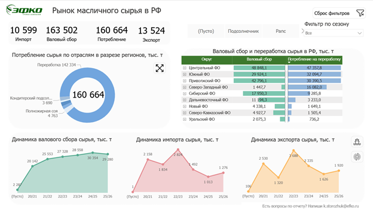
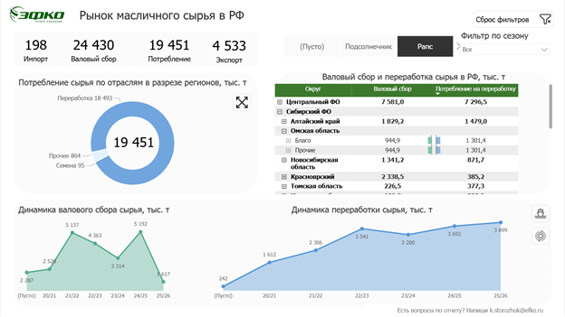

# Рынок масличных культур и продуктов переработки

**Power BI-кейс: региональные балансы, производители и сезонная динамика**

Отчёт объединяет анализ масличного сырья, растительных масел и шротов. Пользователь может перейти от обзора рынка к региону, холдингу и заводу, изменить сырьё и сезон и сопоставить показатели с временной динамикой.

Power BI · Power Query M · DAX · Excel · моделирование данных

## Как выглядит отчёт

### Обзор рынка сырья



**Состояние:** Сезон: «Все»; отдельная культура не выделена.

Верхняя строка даёт обзор KPI, кольцевая диаграмма показывает направления потребления, матрица — территориальную детализацию. Нижние графики связывают общий срез с сезонной динамикой.

### Рапс: детализация таблицы и переключение динамики



**Состояние:** Культура: «Рапс»; сезон: «Все»; раскрыта территориальная матрица; нижний правый график показывает переработку.

Другой вид сырья исследуется в той же композиции экрана. Детализация матрицы и график переработки позволяют сопоставить структуру производства с сезонной динамикой.

[Все состояния в галерее: 3](docs/GALLERY.md) · [Интерфейс и навигация](docs/REPORT_GUIDE.md) · [Модель данных](docs/ARCHITECTURE.md).

## Задача

- Свести разнородные балансы сырья, масел и шротов в согласованные аналитические разрезы.
- Показать сбор, производство, переработку, потребление и внешнюю торговлю с явными единицами измерения.
- Дать возможность исследовать структуру потребления и положение производителей без подготовки отдельной презентации для каждого среза.

## Выполненная работа

- Подготовка региональных и заводских данных в Power Query M: очистка многострочных форм, восстановление группировок, Unpivot, типизация и объединение потоков.
- Модель с тремя тематическими ветвями, общими справочниками и составным ключом региона, сырья и даты.
- DAX-меры суммарных показателей; аналитический интерфейс с KPI, структурой потребления, матрицей и динамикой.
- Срезы сырья/сезона, иерархия территорий и производителей, drill-down и переключение графиков через bookmarks.

## Результат

Подготовлен многостраничный интерактивный отраслевой отчёт. Артефакты показывают путь от подготовки исходных форм к модели данных и аналитическому интерфейсу. Количественная экономия времени, аудитория и эффект на бизнес-решения в предоставленных материалах не измерены.

## Что демонстрирует кейс

BI-аналитик, BI-разработчик, аналитик данных: Power Query, моделирование нескольких фактов, DAX и визуальный анализ.

Модель содержит 10 бизнес-таблиц, 15 связей и 8 явных DAX-мер. M-запросы в комплекте: подготовительный слой — 22, модель Power BI — 10.

## Технический разбор

- [Полная галерея экранов и состояний фильтров](docs/GALLERY.md).
- [Модель, зерно, связи и trade-offs](docs/ARCHITECTURE.md).
- [Power Query: обработка исходных форм и подготовка модели](docs/DATA_PREPARATION.md).
- [DAX: меры, вычисляемые таблицы и столбцы](docs/METRICS.md).
- [Интерфейс и сценарии использования](docs/REPORT_GUIDE.md).
- [Проверки расчётов и ограничения](docs/VALIDATION.md).
- [Как читать и восстановить проект](docs/REPRODUCING.md).
- [Дополнительные схемы компоновки страниц](docs/LAYOUTS.md).

## Состав repository

```text
assets/screenshots/      настоящие экраны отчёта и индекс изображений
assets/                  дополнительные схемы модели и страниц
docs/                    архитектура, ETL, метрики, интерфейс и проверки
src/power-query/source/  запросы подготовительных Excel-книг
src/power-query/model/   запросы семантической модели Power BI
src/power-query/parameters/  параметры путей
src/dax/                 меры, вычисляемые таблицы и столбцы
src/relationships.csv    ключи и направления фильтрации
```

Repository показывает выполненный отчёт на настоящих снимках, его архитектуру и код. Исходные таблицы данных и PBIX не включены, поэтому автономный Refresh после клонирования не заявлен. M/DAX при подготовке не исполнялись; правила проверок перечислены отдельно. [Состав и права](RIGHTS.md).
