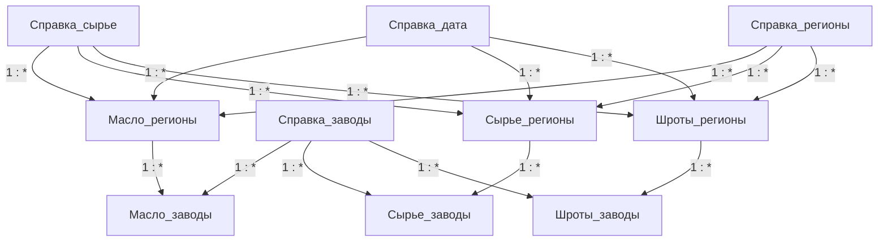

# Модель данных

Региональные факты: регион × код сырья × дата. Заводские факты: завод × региональный составной ключ. Общие справочники: даты, сырьё, регионы, заводы/холдинги.

В модели 10 бизнес-таблиц и 15 бизнес-связей. Служебные Auto date/time и структуры хранения VertiPaq не включены в это число.

## Таблицы и зерно

| Таблица | Назначение и зерно | Поля |
|---|---|---|
| `Масло_заводы` | Завод × Ключ региона: производство, экспорт и направления потребления масла. | `Федеральный округ`, `Завод`, `Ключ региона`, `Производство`, `Экспорт`, `Потребление`, `Потребление на промышленные жиры`, `Потребление на майонез`, `Потребление на фасовку` |
| `Масло_регионы` | Регион × код сырья × дата: импорт, потребление, запасы и отрасли потребления масла. | `Код сырья`, `Регион`, `Дата`, `Запасы на начало месяца`, `Импорт`, `Потребление`, `Потребление на промышленные жиры`, `Потребление на майонез`, `Потребление на фасовку`, `Потребление на комбикорма`, `Прочее потребление`, `Остатки на конец месяца`, `Ключ региона` |
| `Справка_дата` | Уникальные даты из Масло_регионы; сезон, год и месяц. | `Дата`, `Год`, `Месяц`, `Сезон`, `Сортировка` |
| `Справка_заводы` | Справочник заводов и холдингов. | `Холдинг`, `Завод` |
| `Справка_регионы` | Справочник регионов, округов и стран. | `Регион`, `Округ`, `Округ_краткий`, `Страна` |
| `Справка_сырье` | Справочник кодов сырья, построенный из Масло_регионы. | `Код сырья`, `Сырье` |
| `Сырье_заводы` | Завод × Ключ региона: потребление сырья на переработку. | `Потребление на переработку`, `Ключ региона`, `Завод` |
| `Сырье_регионы` | Регион × код сырья × дата: валовый сбор, импорт, экспорт, потребление и потери сырья. | `Регион`, `Дата`, `Код сырья`, `Импорт`, `Валовый сбор`, `Экспорт`, `Потребление на переработку`, `Потребление на кондитерский подсолнечник`, `Потребление на семена`, `Потери`, `Потребление на полножирную сою`, `Потребление на производство жмыха`, `Прочее потребление`, `Ключ региона`, `Потребление` |
| `Шроты_заводы` | Завод × Ключ региона: производство и экспорт шрота. | `Завод`, `Ключ региона`, `Производство`, `Экспорт_завод` |
| `Шроты_регионы` | Регион × код сырья × дата: баланс шрота и потребление по видам животноводческой продукции. | `Регион`, `Дата`, `Код сырья`, `Запасы на начало месяца`, `Импорт`, `Экспорт_регион`, `Потребление`, `Приток/отток (РФ)`, `Остатки на конец месяца`, `Ключ региона`, `Свинина`, `Говядина`, `Птица`, `Молоко`, `Яйца`, `Рыба (карповые)`, `Рыба (лососевые)` |

## Направления фильтрации

Стрелки показывают распространение фильтра, двунаправленная стрелка означает Both. Кардинальности и ключи перечислены отдельно; рисунок не заменяет проверку уникальности данных.

| Сторона 1 | Сторона * | Фильтрация | Активна |
|---|---|---|---|
| `Справка_сырье[Код сырья]` | `Масло_регионы[Код сырья]` | Single | Да |
| `Справка_дата[Дата]` | `Масло_регионы[Дата]` | Single | Да |
| `Справка_заводы[Завод]` | `Масло_заводы[Завод]` | Single | Да |
| `Масло_регионы[Ключ региона]` | `Масло_заводы[Ключ региона]` | Single | Да |
| `Справка_регионы[Регион]` | `Масло_регионы[Регион]` | Single | Да |
| `Справка_сырье[Код сырья]` | `Сырье_регионы[Код сырья]` | Single | Да |
| `Справка_регионы[Регион]` | `Сырье_регионы[Регион]` | Single | Да |
| `Справка_заводы[Завод]` | `Сырье_заводы[Завод]` | Single | Да |
| `Справка_дата[Дата]` | `Сырье_регионы[Дата]` | Single | Да |
| `Сырье_регионы[Ключ региона]` | `Сырье_заводы[Ключ региона]` | Single | Да |
| `Справка_заводы[Завод]` | `Шроты_заводы[Завод]` | Single | Да |
| `Шроты_регионы[Ключ региона]` | `Шроты_заводы[Ключ региона]` | Single | Да |
| `Справка_дата[Дата]` | `Шроты_регионы[Дата]` | Single | Да |
| `Справка_сырье[Код сырья]` | `Шроты_регионы[Код сырья]` | Single | Да |
| `Справка_регионы[Регион]` | `Шроты_регионы[Регион]` | Single | Да |

## Решения и trade-offs

### Разные уровни фактов

Региональные балансы и заводская переработка хранятся на разном зерне. Это сохраняет смысл исходных данных, но региональную сумму нельзя автоматически интерпретировать как показатель завода.

### Составной ключ

Регион + код сырья + дата связывают тематические факты. Для обновления важно одинаковое текстовое представление даты и уникальность ключа на стороне 1.

### Повторяемая композиция

Три тематические страницы используют близкую структуру: KPI, потребление, детализация и динамика. Пользователь переносит знакомый способ анализа между сырьём, маслами и шротами.

[Вернуться к обзору](../README.md).
