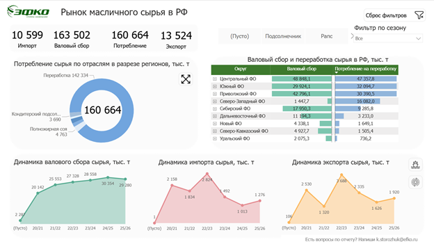
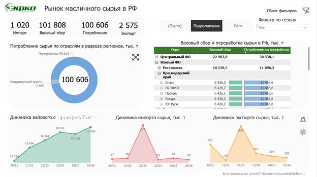
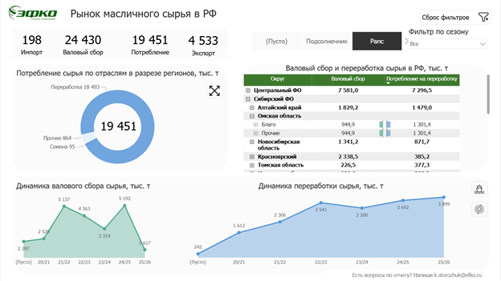

# Отчёт в работе: экраны и аналитические состояния

Настоящие снимки выполненного Power BI-отчёта. PNG перенесены без изменения пикселей; это сохранённые состояния, не реконструкция интерфейса и не текущая сводка рынка. Подписи описывают видимые выборы на экранах, а не только названия исходных файлов. Клики и Refresh при подготовке галереи не запускались.

## 1. Обзор рынка сырья

**Состояние:** Сезон: «Все»; отдельная культура не выделена.

Верхняя строка даёт обзор KPI, кольцевая диаграмма показывает направления потребления, матрица — территориальную детализацию. Нижние графики связывают общий срез с сезонной динамикой.

## 2. Подсолнечник и раскрытие региональной иерархии

**Состояние:** Культура: «Подсолнечник»; сезон: «Все»; в матрице раскрыт Краснодарский край до холдингов.

Кадр показывает анализ выбранного сырья и переход от территории к участникам рынка. KPI, структура потребления и динамика представлены рядом с раскрытой иерархией; смысл региональных сумм на нижнем уровне рассматривается в технических проверках.

## 3. Рапс: детализация таблицы и переключение динамики

**Состояние:** Культура: «Рапс»; сезон: «Все»; раскрыта территориальная матрица; нижний правый график показывает переработку.

Другой вид сырья исследуется в той же композиции экрана. Детализация матрицы и график переработки позволяют сопоставить структуру производства с сезонной динамикой.

[Обзор проекта](../README.md) · [Интерфейс и навигация](REPORT_GUIDE.md) · [Модель](ARCHITECTURE.md) · [Проверки расчётов](VALIDATION.md).
