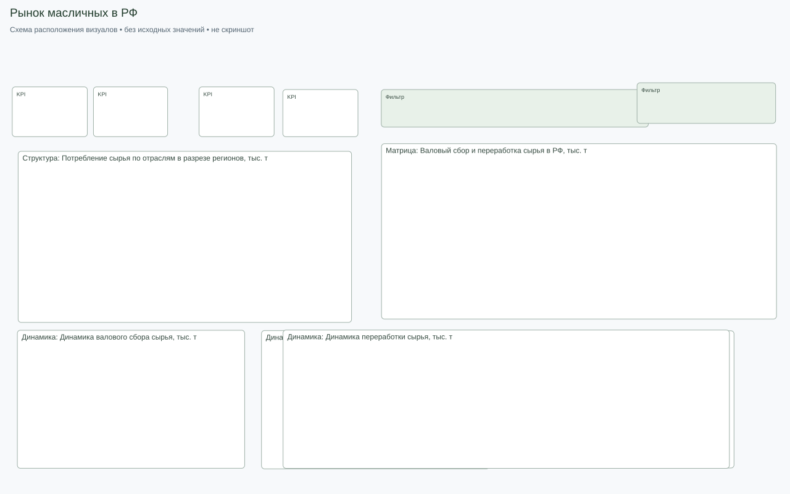
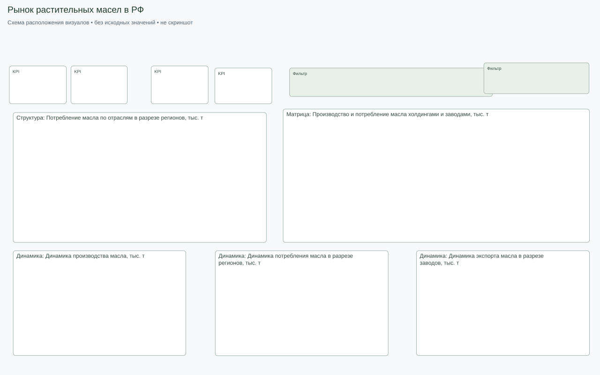
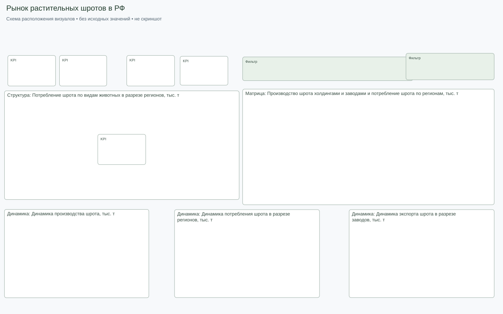

# Схемы компоновки страниц

Вспомогательные схемы по метаданным PBIX. Настоящие экраны и состояния находятся в [галерее](GALLERY.md). Схемы не воспроизводят данные, оформление, клики и все состояния bookmarks.

### Рынок масличных в РФ

### Рынок растительных масел в РФ

### Рынок растительных шротов в РФ

[Обзор проекта](../README.md).
